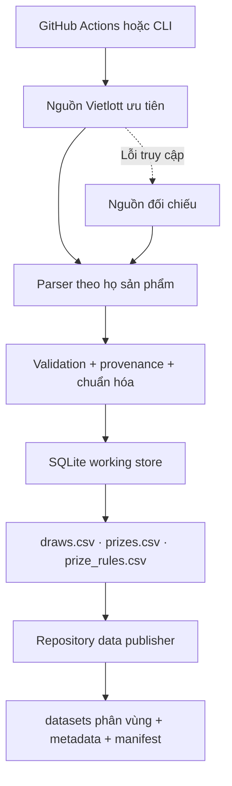

# Kiến trúc Vietlott Data Collector

## Thành phần

- `config.py`: danh mục sản phẩm, endpoint, miền số và kích thước trang.
- `http.py`: session, retry, backoff, `Retry-After`, rate limit và jitter.
- `sources/`: nguồn Vietlott chính thức và nguồn đối chiếu khi cần.
- `parsers/`: chuyển HTML/Ajax thành `DrawRecord` và `PrizeRecord`.
- `validation.py`: kiểm tra số lượng, miền giá trị, trùng số và cấu trúc giải.
- `provenance.py`: lưu nguồn, mức đối chiếu và các chuyển trạng thái được phép.
- `storage.py`: upsert theo khóa ổn định, SQLite và xuất CSV/Parquet.
- `incremental_update.py`: cập nhật định kỳ, đối chiếu vùng gần nhất và fallback.
- `full_backfill.py`, `keno_history.py`, `keno_gap_repair.py`: thu thập lịch sử và sửa khoảng trống có bằng chứng.
- `repository_data.py`: hydrate, publish, validate và tạo metadata snapshot.
- `quality.py` và `audit.py`: kiểm tra tính đầy đủ, trùng khóa, schema, nguồn và kích thước tệp.

## Nguyên tắc bất biến

- Nguồn quyết định kỳ nào tồn tại; lịch chỉ quyết định lúc thăm dò.
- Không suy mã kỳ kế tiếp và không nội suy kết quả còn thiếu.
- Upsert không tạo bản ghi trùng và không xóa bản ghi bị rút xác nhận.
- Nguồn phụ không ghi đè bản ghi chính thức nếu chưa có quy tắc đối chiếu.
- Mọi thay đổi dữ liệu phải đi qua `publish` và `validate`.
- Metadata được sinh lại từ snapshot, không chỉnh tay để làm đẹp số liệu.

## Mở rộng

Thêm `ProductSpec` trong `config.py`, fixture parser và test dữ liệu tương ứng. Nếu mô hình `DrawRecord`/`PrizeRecord` vẫn đủ trường thì không cần thay đổi tầng lưu trữ.
